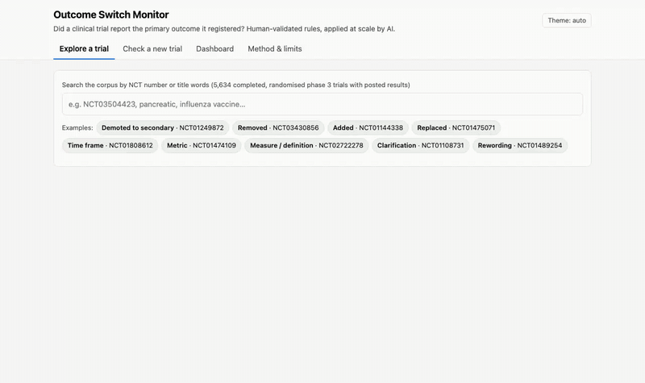
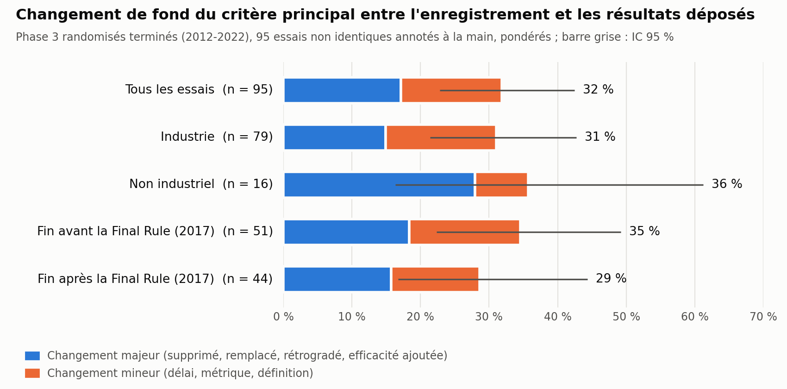

# Outcome Switch Monitor

Avant de commencer, un essai clinique doit déclarer dans un registre public son critère principal : ce qu'il va mesurer, et quand. À la fin, les résultats déposés sont censés porter sur ce même critère. Ce projet vérifie si c'est vraiment le cas, sur 5 634 essais de phase 3 de ClinicalTrials.gov.

On l'a fait à 4 pendant le **HSIL Hackathon** (7e édition, 10-11 avril 2026, emlyon business school), organisé par le HITS Institute dans le cadre d'une initiative du Health Systems Innovation Lab de Harvard, sur le thème de l'IA dans les systèmes de santé. J'ai repris le dépôt après coup pour le nettoyer.



*(la même chose en [mp4](demo/media/walkthrough.mp4))*

## Ce qu'on a trouvé

Environ **un essai sur trois** modifie le fond de son critère principal entre l'enregistrement et le dépôt des résultats (32 %, IC 95 % 23–42). Un sur six le fait de façon majeure : critère supprimé, remplacé ou passé en secondaire (17 %, IC 11–27).

Ces chiffres viennent de 95 essais annotés à la main par deux personnes indépendamment, avec arbitrage des désaccords. L'échantillon est petit, donc il faut les lire comme des ordres de grandeur. Une discordance n'est pas forcément une faute : le changement peut être justifié et expliqué dans l'article.



## Comment ça marche

La difficulté, c'est que 88 % des essais changent le *texte* de leur critère, presque toujours pour une simple reformulation (« Proportion of patients » devient « Percentage of participants »). Comparer les chaînes de caractères ne sert donc à rien. Il faut juger si le fond a changé.

1. **Collecte** : l'API de ClinicalTrials.gov donne l'état actuel de chaque essai. La version enregistrée au départ n'est plus accessible sur le site depuis mars 2026. Heureusement, Internet Archive en avait archivé les réponses en février 2025 : on la récupère dans la Wayback Machine, en trouvant la bonne version par dichotomie.
2. **Règles** : on a écrit des règles d'annotation explicites ([`classify/GUIDELINES.md`](classify/GUIDELINES.md)), inspirées de Zarin et al. (2011). Le verdict est identique, reformulation, précision ou changement. Pour un changement, on note aussi le type et la gravité.
3. **Annotation humaine** : 95 essais tirés au hasard, chacun annoté deux fois à l'aveugle. L'accord de départ était moyen (kappa 0,44). On a donc précisé les règles ensemble ([`classify/QUESTIONS.md`](classify/QUESTIONS.md)), puis une quatrième personne a arbitré les désaccords.
4. **LLM** : on a testé 4 modèles avec les mêmes règles comme prompt, et comparé leurs réponses aux étiquettes humaines. Gemini 2.5 Flash a été retenu (kappa 0,73 sur « changement oui/non »). Il a ensuite classé les 4 874 essais restants pour 3 $.
5. **Démo** : une appli web locale pour explorer chaque essai (critères enregistrés et déposés comparés mot à mot, historique des versions), un tableau de bord, et la possibilité de classer en direct un essai qui n'est pas dans le corpus.

Le détail (plan de sondage, accords, comparaison des modèles, limites) est dans [METHODE.md](METHODE.md).

## L'équipe

On était 4 (BF, CM, TJ, AB), avec en gros cette répartition :

- **BF** (moi) : la collecte (API + Wayback), la construction des paires enregistré / déposé, et le serveur de la démo
- **CM** : la partie LLM (prompt, classement, comparaison des modèles, traduction des notes)
- **AB** : les règles d'annotation, le plan de sondage, les stats, et l'arbitrage
- **TJ** : les pages d'annotation et d'arbitrage, l'interface web, les tests

BF, CM et TJ ont aussi fait l'annotation.

## Lancer la démo

Il faut Python 3.12. Je ne l'ai testé que sur macOS.

```bash
python3.12 -m venv .venv && .venv/bin/pip install -r requirements.txt
demo/run.sh            # http://127.0.0.1:8000
```

Les données de la démo sont dans le repo, donc l'exploration et le tableau de bord marchent hors ligne. Pour classer un essai en direct, il faut une clé [OpenRouter](https://openrouter.ai) :

```bash
OPENROUTER_API_KEY=sk-or-... demo/run.sh
```

Pour les tests (API + navigateur, avec un faux modèle donc rien de payant) :

```bash
.venv/bin/pip install -r requirements-dev.txt && .venv/bin/python -m playwright install chromium
.venv/bin/python -m pytest tests
```

## Refaire tout le pipeline

Les données brutes (~540 Mo) ne sont pas dans le repo, sauf pour les essais d'exemple. La collecte prend une dizaine d'heures, à cause de la Wayback Machine.

```bash
.venv/bin/python collect/run.py                  # collecte, peut être coupée et relancée
.venv/bin/python classify/build_items.py         # paires -> data/items.jsonl
.venv/bin/python validation/build_annotate.py    # page d'annotation
.venv/bin/python validation/agreement.py         # accord + désaccords
.venv/bin/python validation/build_adjudicate.py  # page d'arbitrage
.venv/bin/python validation/import_labels.py     # -> data/labels.jsonl
.venv/bin/python analysis/analyze.py             # -> analysis/results.md
(cd analysis && ../.venv/bin/python figure.py)
OPENROUTER_API_KEY=... .venv/bin/python classify/llm_classify.py --eval
OPENROUTER_API_KEY=... .venv/bin/python classify/llm_classify.py --workers 16 --max-cost 15
.venv/bin/python demo/build_data.py --warm
```

Côté technique : Python (requests, pandas, statsmodels, scikit-learn, matplotlib), un serveur HTTP de la lib standard, une page web en JS sans framework avec des graphes en SVG faits à la main, pytest et Playwright pour les tests.

## Limites / à faire

- 95 essais, c'est peu : les intervalles de confiance sont larges.
- Le LLM a été évalué sur les mêmes 95 essais que ceux qui ont servi à le choisir et à préciser les règles, donc son score est sûrement un peu optimiste. Il faudrait un nouvel échantillon annoté, réservé au test.
- On compare le registre aux résultats déposés sur ClinicalTrials.gov, pas aux articles publiés.
- Tout l'historique dépend de la copie d'Internet Archive de février 2025.
- On ne sait pas encore dater le changement de fond, seulement la première modification du texte.
